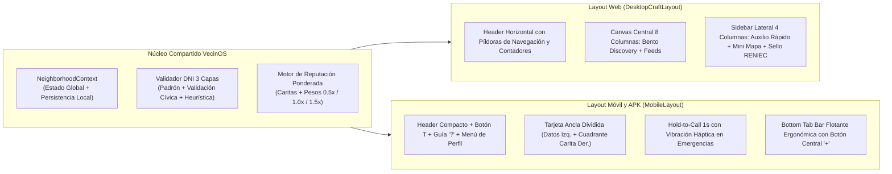
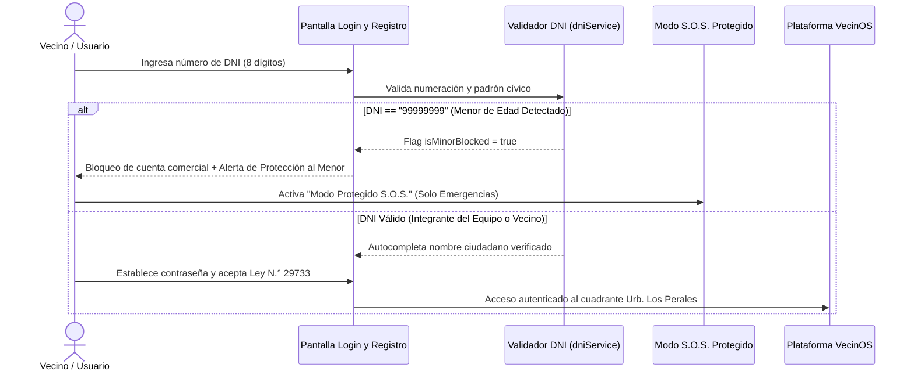

# Reporte Integral de Flujos, Funcionalidades y Características — VecinOS

> **Documento Técnico de Referencia para el Equipo de Desarrollo y Sustentación**  
> **Proyecto:** VecinOS — Plataforma Barrial de Economía Colaborativa y Soporte en Emergencias  
> **Piloto Comunitario:** Urb. Los Perales, Yanahuara (Arequipa)  
> **Evento:** 8.ª Hackathon UTP – El Comercio 2026  
> **Equipo:** Rafael Ramirez, Bryan Mango, Anthony Luque, Gustavo Mendoza, Elisvan Choque

---

## 1. Propuesta de Valor y Concepto Central

**VecinOS** es una plataforma hiperlocal de **economía colaborativa barrial, ayuda mutua y respuesta temprana ante emergencias**, diseñada específicamente para el contexto urbano de **Yanahuara / Urb. Los Perales (Arequipa)**.

### Problemas Reales que Resuelve:
1. **Caos en chats vecinales:** En los grupos informales de mensajería (WhatsApp), los pedidos y avisos críticos (una fuga de agua, un adulto mayor que requiere oxígeno, el préstamo de unas muletas o el aviso de una persona sospechosa) se pierden en minutos entre cientos de mensajes irrelevantes, stickers y cadenas.
2. **Desconfianza e inseguridad domiciliaria:** Contratar un oficio (cerrajero, gasfitero, electricista) de fuentes callejeras o volantes implica un riesgo directo para la seguridad de la vivienda.
3. **Barrera económica y falta de liquidez:** Muchas familias cuentan con habilidades técnicas, oficios o bienes para intercambiar (**trueque**), pero las plataformas comerciales tradicionales exigen cobros bancarizados y retienen comisiones elevadas.
4. **Vulnerabilidad y desarticulación ante desastres:** Durante lluvias intensas (ingreso de torrenteras en Arequipa), sismos o cortes prolongados de energía eléctrica, no existe un mapa vivo en la manzana que identifique quién necesita auxilio urgente y quién dispone de recursos críticos de soporte (botiquín, linternas, generador, sacos terreros).

### Solución VecinOS:
* **Radio de acción hiperlocal de 500 metros (< 10 minutos a pie):** Todo intercambio ocurre entre residentes reales de la misma manzana o urbanización.
* **Cero comisiones e intermediarios:** Trato directo mediante llamada telefónica, mensajería, efectivo, billetera digital (Yape/Plin) o **Trueque Solidario sin dinero**.
* **Identidad ciudadana validada (DNI / RENIEC) + Reputación por Caritas:** Confianza respaldada por vecinos de carne y hueso con ponderación comunitaria según su tiempo y trayectoria en el barrio.
* **Doble interfaz adaptativa y resiliencia offline:** Funciona como aplicación web de escritorio y como aplicación móvil nativa instalada vía APK para Android (y PWA para iOS), manteniendo operatividad total aun si colapsa la red de internet.

---

## 2. Arquitectura de Interfaz: Doble Layout Adaptativo (Web + Móvil / APK)

El sistema implementa una arquitectura de **Doble Layout Nativo** que adapta la disposición espacial, la ergonomía y los gestos táctiles según el dispositivo:

### Cuadro Comparativo de Experiencia por Plataforma:

| Dimensión | Versión Web Escritorio (`DesktopCraftLayout`) | Versión Móvil y APK Nativo (`MobileLayout`) |
| :--- | :--- | :--- |
| **Navegación Principal** | Barra superior con 4 pestañas interactivas, contadores dinámicos y botón `+ Publicar en el Barrio`. | **Barra inferior flotante (*Bottom Tab Bar*)** ergonómica al pulgar con botón central verde `+`. Se eliminan pestañas redundantes en la cabecera. |
| **Tarjeta de Identidad Barrial** | Disposición horizontal en 3 bloques: Escudo DNI + Urbanización a la izquierda, **píldora central `[ 😊 Reputación Ejemplar ]`**, y conteo de oficios y favores a la derecha. | Disposición dividida lado a lado: Datos de urbanización y conteos a la izquierda, y **cuadrante vertical de Reputación con carita representativa grande** a la derecha. |
| **Teléfonos de Auxilio Rápido** | Panel lateral derecho permanente con copiado rápido de número telefónico en 1 clic (`Serenazgo`, `Bomberos 116`, `SAMU 106`, `Policía 105`). | **Interacción *Hold-to-Call* (Mantener 1 segundo):** Anillo de progreso animado y vibración háptica antes de abrir el marcador del teléfono para prevenir llamadas accidentales en el bolsillo. |
| **Accesibilidad Inclusiva (`Botón T`)** | Conmutador de **Modo Letra Grande** en cabecera superior que amplía tipografías y botones para adultos mayores. | Botón `T` accesible en la esquina superior derecha, contiguo a la guía rápida `?` y al selector de cuenta. |
| **Retorno al Inicio (Scroll)** | Clic sobre el logotipo regresa a la pantalla principal y ejecuta un desplazamiento suave hacia la parte superior (`top: 0`). | Toque sobre el logotipo retorna al inicio y sube fluidamente al tope de la vista móvil. |

---

## 3. Flujos Principales del Sistema (Paso a Paso)

### Flujo 1: Identificación Ciudadana, Registro y Protección al Menor
* **Archivos clave:** `src/components/auth/LoginOnboardingView.tsx`, `src/services/dniService.ts`

1. **Autenticación e Identidad Cívica:**
   - Permite alternar con fluidez entre **"Iniciar Sesión"** y **"Crear Cuenta"**.
   - Admite cualquier combinación válida de 8 dígitos numéricos, incluyendo los DNIs precargados de los integrantes del equipo.
   - Al digitar los 8 dígitos durante el registro, el sistema autocompleta el nombre formal del ciudadano.
2. **Cumplimiento Legal (Ley N.° 29733 de Protección de Datos Personales):**
   - Modal interactivo con los términos, condiciones y políticas de privacidad, detallando que los datos cívicos solo se emplean dentro del perímetro barrial.
3. **Escudo de Protección al Menor de Edad (`DNI 99999999`):**
   - Si un menor intenta registrarse (simulado con el DNI de prueba `99999999`), el sistema **restringe la creación de una cuenta comercial o pública** para resguardar su integridad física y psicológica.
   - En su lugar, habilita el botón **"Entrar en Modo Protegido S.O.S."**: el menor visualiza los teléfonos de auxilio y puede emitir un aviso de emergencia sin exponer su identidad ni participar en transacciones.
4. **Acceso de Emergencia sin Credenciales:**
   - En la base del login se ubica el botón de acceso directo *"¿Estás en una emergencia? Acceso directo S.O.S. sin DNI"*, habilitando auxilio inmediato en situaciones críticas sin demoras de inicio de sesión.

---

### Flujo 2: Macro Descubrimiento Barrial (Bento Discovery)
* **Archivo clave:** `src/components/home/HomeBentoDiscovery.tsx`

1. **Cabecera Contextual Dinámica:**
   - Indicador en tiempo real `YANAHUARA · RED ACTIVA`, perímetro de cobertura (`Radio 500m`) y saludo personalizado según la cuenta activa (ej. *"Buenos días, Rafael. Tu barrio despierta en calma y solidaridad"*).
2. **Cuadrícula Bento de 6 Accesos Rápidos:**
   - **Cocina Casera:** Comida del día, postres y viandas de vecinos (aplica filtro gastronómico y realiza scroll automático hacia las tarjetas).
   - **Oficios del Hogar:** Cerrajería, gasfitería, electricidad y mantenimiento (filtra servicios técnicos con desplazamiento suave).
   - **Pool Escolar:** Movilidad solidaria compartida hacia colegios del distrito (transiciona con vibración háptica hacia la pestaña de Favores).
   - **Préstamo Barrial:** Herramientas y equipamiento de salud 100% gratuitos (transiciona hacia Favores).
   - **Trueque Solidario:** Filtra al instante las publicaciones que admiten intercambio no dinerario.
   - **Auxilio S.O.S.:** Conexión inmediata con el módulo de emergencias y números de auxilio vecinal 24/7.

---

### Flujo 3: Oficios Locales, Saberes y Trueque Vecinal
* **Archivo clave:** `src/features/services/ServicesView.tsx`

1. **Buscador y Filtros Acumulables:**
   - Búsqueda en vivo por nombre de oficio, vecino o palabra clave.
   - Píldoras de filtrado por categoría (*Todos, Comida casera, Hogar y oficios, Clases, Cuidado y paseo, Salud, Brigada*).
   - Filtros rápidos simultáneos: **`Acepta trueque`** y **`< 5 min a pie`**.
2. **Estructura de la Tarjeta de Servicio:**
   - **Distancia y proximidad a pie:** Cálculo peatonal en metros y minutos (ej. *"2 min a pie · 155m"*).
   - **Nombre cívico verificado:** Nombre completo del vecino conforme al padrón, sin apodos ni títulos añadidos, con sello de verificación.
   - **Métodos de pago habilitados:** Etiquetas de *Efectivo*, *Yape / Plin* y *Trueque*.
   - **Caja de Intercambio Aceptado:** Detalle de qué bienes o servicios solicita el vecino a cambio (ej. *"Acepto frutas frescas, insumos de repostería o clases de inglés"*).
3. **Mecanismo de Propuesta de Trueque en Vivo:**
   - El vecino interesado pulsa **"Proponer trueque"**, redacta su propuesta (ej. *"Te cambio 2 fuentes de lasaña por mantenimiento de laptop"*) y la envía.
   - La propuesta se visualiza de inmediato en la tarjeta con estado `pendiente`, permitiendo su aceptación en un clic (`aceptado`).
4. **Gestión de Publicación Propia:**
   - Cuando el usuario visualiza una publicación creada por su cuenta, el sistema muestra el distintivo **"Tu anuncio"**, permite eliminarla (🗑️) y **bloquea la opción de autocalificación** para evitar distorsiones en la reputación, manteniendo legibles los comentarios del resto de vecinos.

---

### Flujo 4: Reputación por "Caritas" y Ponderación Comunitaria
* **Archivos clave:** `src/features/services/ServicesView.tsx`, `src/context/NeighborhoodContext.tsx`

Para que el sistema sea intuitivo tanto para un joven como para un adulto mayor de 80 años, se descartan métricas numéricas complejas o estrellas comerciales y se implementa un **Semáforo de Conducta Ciudadana**:

| Nivel de Reputación | Representación Visual | Rango de Aprobación | Significado Vecinal |
| :--- | :---: | :---: | :--- |
| **Conducta Ejemplar** | 😊 Verde Esmeralda | $\ge 80\%$ de aprobación | Vecino altamente confiable, avalado formalmente por residentes de su cuadra. |
| **Conducta Aceptable** | 😐 Ámbar / Amarillo | $50\% - 79\%$ de aprobación | Desempeño regular o vecino en proceso de consolidar historial cívico. |
| **Conducta a Mejorar** | 😟 Rojo Coral | $< 50\%$ de aprobación | Alerta preventiva frente a demoras o incumplimientos en acuerdos previos. |

* **Motor Ponderado Anti-Manipulación:**  
  $$\text{Calificación Final} = \frac{\sum (\text{Voto}_i \times \text{Peso}_i)}{\sum \text{Peso}_i}$$
  - *Vecino Referente* (>12 meses en la urbanización): Peso `1.5x`.
  - *Vecino Activo*: Peso `1.0x`.
  - *Cuenta Nueva*: Peso `0.5x`.  
  Esto neutraliza la creación de cuentas fantasmas para inflar reputaciones artificialmente.
* **Transparencia Comunitaria:** Se detallan los nombres de quienes avalan al vecino (*"Avalado por Rafael, Elena, Carmen..."*) y el historial de reseñas con derecho a réplica.

---

### Flujo 5: Cadena de Favores, Solidaridad y Puntos Seguros
* **Archivo clave:** `src/features/favors/FavorsView.tsx`

1. **Dirección Solidaria:**
   - **Ofrezco Apoyo (Verde):** Préstamo gratuito de herramientas (taladro, escalera), equipos médicos (muletas, tensiómetro) o asientos disponibles en ruta escolar (*Pool Escolar*).
   - **Solicito Apoyo (Ámbar):** Pedidos específicos de asistencia comunitaria temporal.
2. **Puntos Seguros de Encuentro:**
   - Como salvaguarda para evitar visitas a domicilios privados en un primer contacto, cada favor define un **Punto Seguro de Encuentro** dentro del vecindario (ej. *Parque Central Los Perales*, *Caseta de Serenazgo Yanahuara*, *Atrio Parroquia San Juan Bautista*).
3. **Ciclo de Gestión del Favor:**
   - Transiciona de estado: `Disponible` $\rightarrow$ `En curso` (al pulsar *"Coordinar apoyo"*) $\rightarrow$ `Completado`, sumando al historial de ayuda comunitaria del vecino.

---

### Flujo 6: Modo Emergencia S.O.S. y Triaje EDAN
* **Archivo clave:** `src/features/emergency/EmergencyView.tsx`

Al seleccionar la pestaña **S.O.S.**, la aplicación activa automáticamente el **Modo Oscuro de Emergencia de Alta Visibilidad**:

1. **Clasificación conforme a la norma EDAN (INDECI):**
   - **Salud y Vida:** Emergencias médicas, balones de oxígeno, primeros auxilios.
   - **Agua y Alimento:** Suministro básico ante cortes de servicio.
   - **Inundación y Lluvia:** Emergencias climáticas, sacos terreros, techos dañados por precipitaciones.
   - **Infraestructura y Energía:** Cables eléctricos expuestos, postes caídos o cortes de energía en la manzana.
2. **Protocolo de Privacidad para Vecinos Vulnerables (`isSensitiveProtected`):**
   - Si una alerta involucra a un adulto mayor solo o a una persona con discapacidad, se activa un **Radio de Protección de 150 metros**, resguardando sus datos domiciliarios hasta que un brigadista cívico registrado asuma la respuesta.
3. **Respuesta Coordinada Comunitaria:**
   - Los vecinos pueden presionar **"En camino a apoyar"**, incorporándose al contador en vivo de brigadistas que acuden al incidente, permitiendo luego marcar el incidente como **"Atendido"**.

---

### Flujo 7: Mapa Comunitario Interactivo
* **Archivo clave:** `src/features/map/NeighborhoodMapView.tsx`

* Integración con **Leaflet y OpenStreetMap**, georreferenciado en **Yanahuara, Arequipa (`-16.3889, -71.5486`)**.
* Marcador central **`TÚ`** con círculo perimétrico de 500 metros.
* Marcadores interactivos diferenciados:
  - **Pines Verdes / Ámbar (`100%`, `75%`):** Oficios locales con su índice de aprobación.
  - **Pines Violeta (`FAV`):** Favores y recursos compartidos disponibles.
  - **Pines Rojos Pulsantes (`SOS`) con halo perimétrico:** Alertas de auxilio activas.
* Al presionar cualquier marcador, se levanta una tarjeta inferior con el resumen, la distancia a pie y el botón de contacto directo.

---

### Flujo 8: Publicación en 3 Clics y Sincronización Inter-Cuentas
* **Archivos clave:** `src/components/publish/QuickPublishSheet.tsx`, `src/services/storageService.ts`

1. **Proceso en 3 Toques (< 15 segundos):**
   - **Toque 1:** Botón central `+`.
   - **Toque 2:** Selección de plantilla o sugerencia rápida (inicia con métodos de pago sin marcar para evitar selecciones accidentales).
   - **Toque 3:** Pulsar *"Publicar en mi cuadra"*.
2. **Persistencia Compartida Multiusuario:**
   - La información se persiste de manera unificada en almacenamiento local estructurado. Si se crea una publicación desde la cuenta de un integrante (ej. Gustavo) y luego se cambia de sesión (ej. Rafael), el nuevo contenido aparece inmediatamente en los feeds y mapas de ambos vecinos.

---

## 4. Herramientas de Demostración y Confiabilidad Técnica

1. **Guía Rápida Interactiva (`?`):**
   - Modal instructivo en 3 pasos (`QuickGuideModal.tsx`) adaptado para pantallas móviles y de escritorio.
2. **Operatividad Offline-First y Empaquetado APK:**
   - Persistencia local mediante cola de sincronización (`SyncQueue`). Si no hay conexión, las alertas y favores se almacenan como `Pendiente de sincronizar` y se transmiten al detectar señal.
   - Empaquetado mediante **Capacitor para Android (`VecinOS.apk`, 4.3 MB)** con ícono esmeralda adaptativo y versión PWA para dispositivos iOS.
3. **Consola Administrativa de Demostración (`/config`):**
   - Oculta al usuario final. Se ingresa mediante la ruta `/config` o dando **5 toques rápidos sucesivos sobre el isotipo del logotipo**.
   - Facilita el cambio de perfil entre los integrantes del equipo en un clic, la simulación de corte de conexión (Offline) y la restauración de la base de datos limpia ante el jurado.
